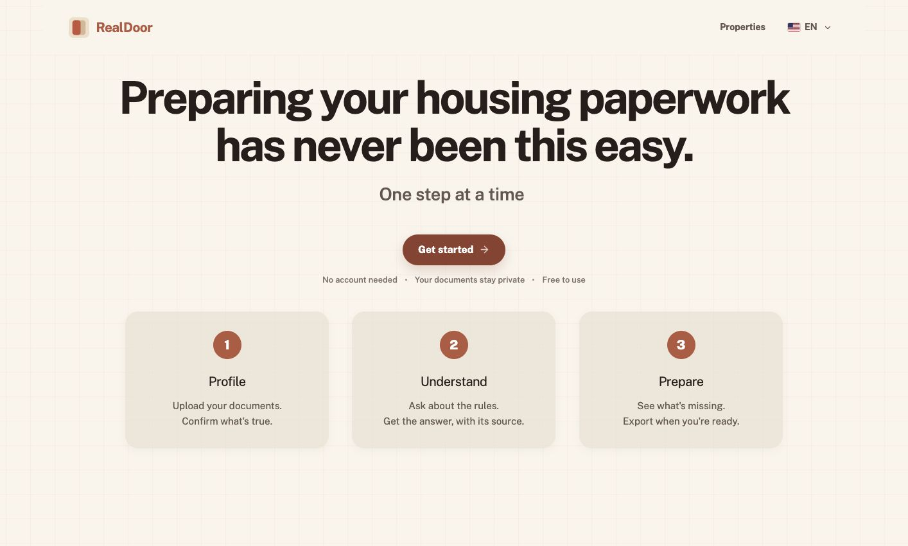

# RealDoor

**Housing paperwork, made clear.**

RealDoor helps renters turn household documents into a reviewed application
packet for affordable housing. Check extracted information against its source,
understand program rules, and prepare the next step for human review.

**[Try the live demo](https://realdoor-boston.vercel.app/)** ·
[Architecture](docs/ARCHITECTURE.md) · [Run locally](#run-locally)



## What you can do

1. **Review your documents.** Upload PDFs, inspect extracted fields alongside
   the source page and highlighted evidence, and confirm or correct each value.
2. **Understand the requirements.** See deterministic income calculations and
   ask questions about the supported program rules, with source citations.
3. **Prepare your packet.** Find missing, expired, or inconsistent documents,
   review the readiness receipt, and download a packet for a human reviewer.

RealDoor prepares and checks application documents. It never decides
eligibility, approval, or priority.

## Try it

Open the [live demo](https://realdoor-boston.vercel.app/) and select **Get
started**. No account is required. The application follows three steps:
**Profile → Understand → Prepare**; the interface supports English, Spanish,
Chinese, Tagalog, and Vietnamese.

This is a Hack-Nation 2026 prototype for the RealPage challenge. Its rules and
income thresholds are frozen to the Boston-area FY2026 LIHTC scenario. Use
synthetic documents for the demo; it is not a general-purpose housing adviser.

## Team and contribution

Built by **Emanuele Rimoldi, Paolo Giaretta, Riccardo Neumarker, and Massimo
Perfetti**.

**Emanuele Rimoldi's contribution:** the property discovery explorer, refinements
to the document-review and application-preparation experience, and frontend
integration with the extraction engine. See the
[contribution history](https://github.com/EmaRimoldi/realdoor/commits/main/?author=EmaRimoldi).

## Run locally

Requirements: Node.js 22 or newer and npm.

```bash
cd frontend
npm ci
npm run dev
```

Open <http://localhost:3000>. See the [development guide](docs/DEVELOPMENT.md)
for engine setup context, testing, service configuration, and manual deployment.

## Technical overview

- **Frontend:** Next.js, React, and TypeScript; source-linked PDF review and
  a localized three-step application flow.
- **Engine:** Python document extraction, deterministic income calculations,
  rules, and document-readiness checks.
- **AI layer:** a bounded, citation-grounded assistant behind a Supabase Edge
  Function, with deterministic checks and a local rules fallback.

## Documentation

| Guide | Contents |
| --- | --- |
| [Architecture](docs/ARCHITECTURE.md) | System diagram, product flow, components, risks, and mitigations |
| [AI specification](docs/AI_SPEC.md) | Assistant behavior, data flow, grounding, and limits |
| [Frontend design](docs/FRONTEND-DESIGN.md) | Visual language, accessibility, and interaction rules |
| [Development](docs/DEVELOPMENT.md) | Local setup, tests, services, and deployment |
| [Build log](docs/BUILDLOG.md) | Implementation history and decisions |

[Project guidance](CLAUDE.md) contains the domain rules and development workflow.
