# RealDoor — Architecture & Risk Note

*Hack-Nation 2026 · Challenge 03 (RealPage) · Team snAI.*

## System overview

```mermaid
---
config:
  theme: base
  themeVariables:
    fontFamily: ''
    fontSize: 15px
    background: '#FBF6EF'
    primaryColor: '#FFFFFF'
    primaryTextColor: '#3D2C24'
    primaryBorderColor: '#C4593F'
    lineColor: '#A8654F'
    clusterBkg: '#FBF6EF'
    clusterBorder: '#D9C7B8'
    edgeLabelBackground: '#FFF9F2'
  flowchart:
    curve: basis
    padding: 12
---
flowchart LR
 subgraph ENGINE["Deterministic engine"]
    direction TB
        B1["<b>Text layer</b><br><i>pdfplumber</i>"]
        B2["<b>OCR fallback</b><br><i>tesseract</i>"]
        B3["<b>Scored matcher</b><br>exact→synonym→fuzzy<br><i>+ anonimized LLM backup</i>"]
  end
 subgraph MATH["Deterministic reasoning — no model in the loop"]
    direction TB
        D["<b>Income math</b><br>integer cents · Decimal<br><i>frozen FY2026 MTSP CSV</i>"]
        Q["<b>Rules Q&amp;A + citations</b><br>frozen 11-rule corpus<br><i>abstains out of corpus</i>"]
  end
 subgraph CONTROL["Renter keeps control — browser memory only"]
    direction TB
        E["<b>File readiness</b><br>READY_TO_REVIEW /<br>NEEDS_REVIEW + coded reasons"]
        F["<b>Packet</b><br>download only — never sent<br>+ delete with proof"]
  end
    B1 --> B2
    B2 --> B3
    D --- Q
    E --> F
    B3 == extracted fields<br>+ evidence ==> C["<b>Renter confirms every value</b><br>evidence: page · bbox · confidence<br>"]
    C == confirmed<br>values only ==> D
    Q ==> G{{"<b>SAFETY GATE</b><br>injection quarantine · never-strings lint<br>guarded LLM I/O — masked, allowlisted, linted<br>never decides eligibility"}}
    G ==> E
    G -.- V(["✓ <b>Verified</b> — 6/6 gold households · 53/53 dev splits<br><i>pytest + vitest + eval harness</i>"])
    B3 -. anonymized labels only .-> G
    C -. AI help .- S["<b>Supabase</b><br>i18n ×5 languages<br>AI-chat Edge Function proxy"]
    S -. pre-gates + decision lint .-> G
    G -.-> O["<b>OpenAI</b><br>sees masked labels /<br>confirmed numbers only —<br>never names, raw text, or files"]
    A["<b>Upload</b><br>PDFs stay in the browser<br>"] --> ENGINE

     B1:::engine
     B2:::engine
     B3:::engine
     D:::engine
     Q:::engine
     E:::browser
     F:::browser
     C:::browser
     G:::safety
     V:::proof
     O:::service
     S:::service
     A:::browser
    classDef browser fill:#FDF3EA,stroke:#C4593F,stroke-width:2px,color:#3D2C24
    classDef engine fill:#EFF4F0,stroke:#2F6B4F,stroke-width:2px,color:#22352C
    classDef safety fill:#B3261E,stroke:#7A130D,stroke-width:3px,color:#FFF7EF,font-weight:bold
    classDef proof fill:#FBF6EF,stroke:#2F6B4F,stroke-width:1px,stroke-dasharray:4 3,color:#22352C
    classDef service fill:#EAF3F8,stroke:#2E6E8E,stroke-width:1.5px,stroke-dasharray:5 3,color:#1F3947
    style ENGINE fill:#F4F8F4,stroke:#2F6B4F,stroke-width:2px
    style MATH fill:#F4F8F4,stroke:#2F6B4F,stroke-width:2px
    style CONTROL fill:#FFFBF5,stroke:#C4593F,stroke-width:2px
```

## Architecture

**Two deliberately separated halves, one contract.**

- **Engine** (`engine/`, Python 3.11 + FastAPI on :8787): deterministic extraction and reasoning.
  PDF → pdfplumber text layer (tesseract OCR fallback) → label-driven scored matcher (exact →
  synonym → fuzzy → prose fallback; confidence = semantic × geometry × recognition) → optional
  anonymized LLM backup (≤2 batched calls, sees masked labels/symbols only — never values, names,
  or boxes) → `DocumentRecord` with per-field page + bbox (PDF points) + calibrated confidence.
  Reasoning: frozen FY2026 MTSP table, income annualization, corroboration, readiness codes,
  rule-corpus Q&A, injection quarantine, decision-language lint, jsonschema-validated submissions.
- **Frontend** (`frontend/`, Next.js 16 + React 19): the renter journey — Profile (upload,
  pdf.js evidence viewer with source boxes, confirm/correct/renter-enter every field), Understand
  (structured income math with per-source formula, threshold + effective date + citations, rules
  chat answering only from the frozen 11-rule corpus), Prepare (readiness reasons, receipt preview,
  downloadable packet, session deletion with visible proof). All state lives in browser memory.
- **The seam:** `NEXT_PUBLIC_ENGINE` swaps a deterministic mock for the real engine without UI
  changes. `lib/engine/http.ts` is the single bbox-conversion point (bottom-left PDF points →
  top-left normalized). The frontend re-derives all math from **confirmed values only** and is
  verified to reproduce the engine's gold results exactly (official 6/6; dev splits 53/53 on
  income, comparison, status, and reason codes; `npm test` covers the math rules).

## Risks & mitigations

| Risk | Mitigation |
|---|---|
| Wrong extraction drives wrong math | Nothing is reused until the renter confirms or corrects it; every value shows its source box + confidence; empty/abstained fields are typed by the renter and marked `renter_entered`. |
| Deciding eligibility (instant DQ) | No decision vocabulary anywhere; comparisons described only against the published limit; decision requests get a fixed negated refusal; engine lints every output string. |
| Prompt injection in documents | Document text is data, never instructions: instruction-like fields are quarantined, displayed transparently, excluded from all math; behavior never changes. |
| Privacy | Files never leave the browser (viewer renders in-memory bytes); AI context sends only confirmed numbers/statuses/references — never files, names, or raw text; deletion wipes state + object URLs and shows a before/after proof. |
| Silent math drift | Deterministic integer-cent math; inclusive threshold boundary pinned by test; frontend↔gold verified across all fixture splits; engine scoreboard (`eval/run_all.py`) plus frontend unit tests. |
| Hidden-test perturbation | No value or name is keyed to household IDs; classification is refined from extracted fields, not filenames; rules answers compute numbers instead of hardcoding them. |
| Offline venue / API failure | Mock engine and local frozen-rule fallback keep the full journey demoable with no network; global error boundary keeps the UI recoverable. |

**Known limitations:** engine remains authoritative for scored submissions (frontend mirrors it);
Supabase is used only for auth + i18n (documents deliberately not persisted); accessibility target
is WCAG 2.2 AA (keyboard-complete, live regions, no color-only signaling).

## Product flow

**One applicant = one application record**, built entirely from uploaded documents. Three header
values recompute after **every** change: **Status** (phase ladder), **Gross Income** (deterministic,
integer cents), **Errors** (rule flags on confirmed values). All are readiness / accuracy /
completeness signals only — never a verdict. The flow is a strict three-phase pipeline (each step
unlocks the next):

1. **Profile** — drag in synthetic PDFs; each is classified against a live checklist (*uploaded* vs
   *still missing* — missing never hard-blocks). The engine extracts **only allowlisted fields**;
   the renter reviews them one at a time — each with the **source page and bounding box highlighted
   in the built-in PDF viewer**, a confidence score, and a plain-language explanation — then
   confirms, corrects, or types the value. **Only confirmed values are used downstream.** Injected
   document text is quarantined, never a field.
2. **Understand** — the income table shows every source annualized by its stated frequency
   (weekly ×52 … annual ×1) against the **frozen FY 2026 60% MTSP threshold** for the household
   size, with formula, effective date, and sources. A **bounded AI assistant** answers rules
   questions with `rule_id` citations and authority badges — greetings get a friendly reply,
   out-of-scope questions get a soft abstain with tappable suggestions, decision requests get a
   refusal.
3. **Prepare** — file readiness (`READY_TO_REVIEW` / `NEEDS_REVIEW`, about the **file**) with coded,
   evidence-linked reasons; a paper-style **SAMPLE readiness receipt** with in-place corrections and
   print-to-PDF; packet download (never transmitted); and delete-session with a deletion proof.

Cross-cutting: everything is reactive; the UI is **fully localized in five languages** (EN, ES, ZH,
TL, VI — the most spoken in the US), switchable at any time; the six official challenge households
reproduce the organizer oracle **exactly** through both the frontend and engine paths.

## AI assistant integration

A narrow, grounded chat panel in the Understand step, served by the Supabase Edge Function
[`supabase/functions/understand-chat`](../supabase/functions/understand-chat):

- **Deterministic pre-gates** catch prompt injection, cross-applicant requests, protected-trait
  inference, legal advice, vacancy questions, wrong-year thresholds, decision requests, greetings,
  and "what are the rules?" — all without a model call.
- In-scope questions go to **OpenAI `gpt-4o`** (Responses API, Structured Outputs, `store: false`)
  with the frozen 11-rule corpus, an app guide, and an **allowlisted numeric context** — never
  files, raw OCR, names, addresses, or filenames. A server-side integrity gate independently
  recomputes all arithmetic before any model call.
- Answers must cite; uncited answers are downgraded, verdict language is lint-rejected, and every
  request is audited **metadata-only** in `ai_request_events` (RLS-denied to browsers) with per-user
  rate limits (5/min, 30/day). If the function or provider is down, a local frozen-rule fallback
  answers in the browser.
